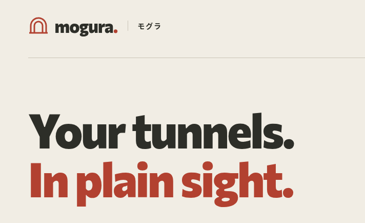

# Mogura (モグラ)

Cloudflare Tunnel routes and Access applications, together. Mogura is a self-hosted dashboard for the services you run.

Managing a homelab often means jumping between tunnel routes, DNS records, Access applications, and policies. Mogura brings them together so you can trace a hostname to its origin and set up its Access application before publishing the route.

## What you can do

- **Follow every route.** Check tunnel health and explore published routes in an interactive map or a searchable table. Search by hostname and filter by matching Access application.
- **Access first. Route second.** Pick a hostname, origin, tunnel, and existing Access policies in one **New service** flow. Mogura creates and verifies the Access application before creating DNS and publishing the route.
- **Manage routes and applications.** Add or remove routes, optionally create their DNS records, and inspect or remove self-hosted Access applications.
- **Keep your existing setup.** Use your Cloudflare account, tunnels, zones, and reusable policies. Mogura preserves unrelated tunnel configuration and the catch-all rule.

Mogura manages existing cloudflared tunnels. It does not run or install `cloudflared`. Route editing requires a remotely managed tunnel; locally managed tunnels are visible, with routes configured in your own YAML file. Create and edit reusable Access policies in Cloudflare.

## Install

You need Docker with Compose, a Cloudflare account with a tunnel and DNS zone, and an API token with the [permissions below](#connect-cloudflare). Have at least one reusable Access policy ready to use the **New service** flow.

Download or clone this repository, open its directory, and run:

```sh
docker compose up -d --build
```

Open **http://localhost:3000**, then connect your account in **Settings**. No `.env` file is needed for this setup. Compose builds the image from source and binds the dashboard to localhost by default.

### Connect Cloudflare

Enter your account ID and a [Cloudflare API token](https://dash.cloudflare.com/profile/api-tokens) in Settings. Scope the token to the account and zones you want to manage:

| Scope | Permission | Used for |
| --- | --- | --- |
| Account | Cloudflare Tunnel: Edit | Read tunnels and manage routes |
| Account | Access: Apps and Policies: Edit | Manage applications and read reusable policies |
| Zone | Zone: Read | List domains for hostname selection |
| Zone | DNS: Edit | Create DNS records, when requested |

Mogura checks access to tunnels, applications, policies, and zones before saving the connection. A global API key with your account email is also supported.

Credentials are encrypted on the server and persist across browser and container restarts. They are shared by everyone who can reach this Mogura deployment. **Mogura has no built-in user login. Protect it with Cloudflare Access before exposing it outside your trusted machine or network.**

### Configuration

For deployment options or environment-based credentials:

```sh
cp .env.example .env
```

Edit the values you need, then run `docker compose up -d --build` again.

| Variable | Default | Purpose |
| --- | --- | --- |
| `APP_ORIGIN` | `http://localhost:3000` | Browser-facing origin; set to your HTTPS URL when using a tunnel |
| `DASHBOARD_PORT` | `3000` | Port published on the Docker host |
| `BIND_ADDRESS` | `127.0.0.1` | Host interface; use `0.0.0.0` for direct LAN access |
| `CLOUDFLARE_ACCOUNT_ID` | Unset | Account ID for environment-based credentials |
| `CLOUDFLARE_API_TOKEN` | Unset | API token for environment-based credentials |
| `SESSION_SECRET` | Generated automatically | Optional encryption-key override, at least 32 characters; keep it stable |

For a global API key, set `CLOUDFLARE_API_KEY` and `CLOUDFLARE_EMAIL` instead of `CLOUDFLARE_API_TOKEN`. Saved credentials take precedence over environment values. **Disconnect account** removes the saved connection for the whole deployment; configured environment credentials remain available as a fallback.

### Expose through a tunnel

1. Protect your dashboard hostname with a Cloudflare Access application and policy.
2. Set `APP_ORIGIN=https://mogura.example.com` in `.env`, using your actual hostname.
3. Point that hostname's tunnel route to `http://localhost:3000` if `cloudflared` runs on the Docker host. If you changed `DASHBOARD_PORT`, use that port.
4. Run `docker compose up -d --build` to apply the configuration.

If `cloudflared` runs in another container, attach it to the same Docker network and use `http://dashboard:3000` as the service URL.

### Update and keep your connection

After downloading the latest source or running `git pull`:

```sh
docker compose up -d --build
docker compose ps
docker compose logs --tail=100 dashboard
```

The `dashboard-data` volume holds the encryption key and encrypted credentials. Preserve this volume when updating or backing up. `docker compose down` keeps it; `docker compose down -v` deletes it. Changing an explicit `SESSION_SECRET` requires reconnecting your account.

## How changes affect your account

- Removing a route keeps its DNS record and Access application. Removing an Access application keeps its route and DNS.
- If route publication fails after the Access application is created, Mogura keeps the application and lets you retry the route. A **Resume service** notice retains the inputs for the current dashboard tab until a full page reload.
- A matching Access application does not by itself guarantee authentication. Its policies determine access, and Cloudflare changes can take time to propagate.
- Avoid editing the same tunnel in multiple tools at once. Mogura checks for configuration changes before writing, but Cloudflare's configuration replacement is not atomic with that check.

## Local development

Built with Bun, TanStack Start, React, and TypeScript. Use Bun 1.4.4 to match the Docker image.

```sh
bun install --frozen-lockfile
bun run dev
```

Open **http://localhost:3000**. Connect through Settings or use `.env`. Local encrypted credentials and their key live in `.data/`, which is excluded from Git.

Run the project checks:

```sh
bun run check
bun test
bun run build
```

To run a production build outside Docker, run `bun run build` followed by `NODE_ENV=production bun run start`. The server defaults to `0.0.0.0:3000`. Keep `.data/` persistent, or configure `SESSION_SECRET_FILE` and `CREDENTIALS_FILE` to persistent paths. Configure `APP_ORIGIN` for your deployment.

## Container images and releases

The [Docker image workflow](.github/workflows/docker.yml) builds Linux AMD64 and ARM64 images and publishes them to **`ghcr.io/pitu/mogura`**. The Docker build runs the typecheck, tests, and production build before publishing.

| Event | Published image tags |
| --- | --- |
| Push to `main`, or a manual workflow run on `main` | `edge`, `sha-<full commit SHA>` |
| Publish a GitHub Release tagged `v0.1.0` | `0.1.0`, `latest`, `sha-<full commit SHA>` |
| Publish a prerelease, such as `v0.2.0-beta.1` | `0.2.0-beta.1`, `sha-<full commit SHA>`; leaves `latest` unchanged |
| Pull request | Builds and checks both platforms without publishing |

Releases are deliberate. Routine pushes do not create GitHub Releases or update `latest`. Use an exact version tag for a deployment you want to keep stable; `edge` follows development on `main`.

To release:

1. Set `version` in `package.json` to the release version, starting with `0.1.0`, and merge or push the change to `main`.
2. In GitHub, open **Releases → Draft a new release**. Create the matching `v0.1.0` tag from `main`, write or generate release notes, and publish it.
3. Wait for the **Docker image** workflow to succeed. The image appears under the repository's **Packages** section. The workflow rejects release tags that do not match `package.json`.

No custom registry secret is needed: publishing uses the repository's `GITHUB_TOKEN`. After the first publication, open the package's settings and change its visibility to **Public** to allow pulls without signing in. Container packages start private, even for a public repository. See [GitHub's Container registry documentation](https://docs.github.com/en/packages/working-with-a-github-packages-registry/working-with-the-container-registry).

Mogura is an independent project and is not affiliated with Cloudflare.
